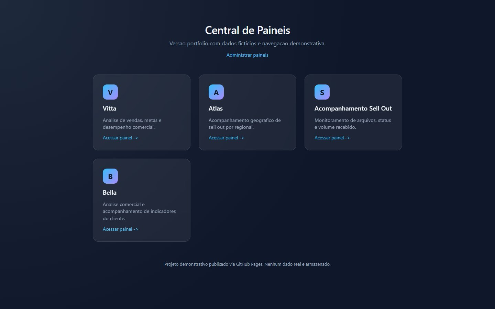

# Central de Painéis - Portfólio

**[Ler o estudo de caso](https://lariantunez.github.io/central-de-paineis/)** · **[Abrir a central](https://lariantunez.github.io/central-de-paineis/app/)**

Versão estática do projeto Central de Painéis para publicação no GitHub Pages.

## O que está nesta versão

- Home com os cards dos painéis.
- Administração aberta, sem login e sem senha.
- Dados fictícios em `app/data/paineis.json`.
- Edições demonstrativas salvas apenas no `localStorage` do navegador.
- Dashboard demonstrativo em `app/painel-demo.html`, sem servidor e sem banco de dados.

## Estrutura

- `index.html`: estudo de caso do projeto (raiz do site).
- `assets/`: estilo, script e imagens do estudo de caso.
- `app/`: a central em si (`index.html`, `admin.html`, `painel-demo.html`, `reset-senha.html` e `data/paineis.json`).
- `404.html`: leva endereços antigos (`admin.html`, `painel-demo.html`, `reset-senha.html`) para `app/` e os demais para a raiz.

## Publicação no GitHub Pages

O site é publicado direto do branch `main`, a partir da raiz. Em `Settings > Pages`, a origem é `Deploy from a branch`, com branch `main` e pasta `/ (root)`.

O site fica disponível em:

`https://lariantunez.github.io/central-de-paineis/`
